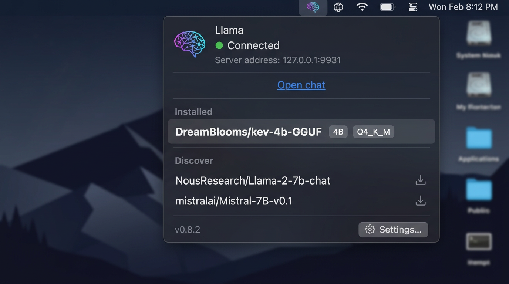

# Llama

Llama is a native macOS menu bar app that runs local large language models on your machine. No cloud, no accounts, no data leaving your computer.



## Install

```sh
brew install --cask llama-app
```

Or download the latest DMG from [Releases](https://github.com/leandroasilva/llama-app/releases).

## What it does

Llama runs a local OpenAI-compatible API server powered by llama.cpp. When you start the app, it listens on `http://localhost:9931/v1` and stays resident in your menu bar. Models load into memory on demand and unload when idle, so they only consume RAM while you're actively using them.

Connect any OpenAI-compatible client — coding agents, chat UIs, editors, or your own scripts — to the local server and talk to your models.

## Features

### 100% local and private

Everything runs on your Mac. Your prompts, completions, and model weights never leave the machine. There is no telemetry, no account system, and no remote dependency beyond downloading models and updates.

### Hardware-aware model recommendations

The app profiles your Mac's memory at launch and recommends models from a curated catalog that fit your hardware. Each recommendation shows the best quantization that runs within your memory budget. One click installs the model.

### Memory profiling and context tiers

When a model is installed, Llama runs a two-point memory probe to build a linear model of how much RAM it uses at different context lengths. The context picker then shows which tiers (4k, 8k, 16k, 32k, 64k, 128k, 256k) fit in your device memory, with the projected cost displayed for each. Tiers that would exceed your RAM are disabled.

### Router mode server

The llama.cpp server process runs continuously. When you switch models, the new one is loaded in-place without restarting the server. The model list is reloaded from disk automatically when you install or delete models, so there's no manual refresh needed.

### Global input with system-wide hotkey

Configure a keyboard shortcut in Settings to summon a Spotlight-style prompt from anywhere on your system. Type a question without switching apps, pick a model with `Cmd+K`, and the prompt is dispatched to the WebUI. The panel targets your last-used model by default.

### Network access control

By default the server binds to localhost only. When you need remote access:

- **Tailscale** — binds to your Tailscale CGNAT address. Encrypted and authenticated by Tailscale, invisible on other networks. Ideal for laptops.
- **This network** — binds to all interfaces (`0.0.0.0`). Use only on trusted networks.

The app monitors network path changes and withdraws access consent when you join a different network, so your server doesn't follow your laptop onto someone else's Wi-Fi.

### Standard Hugging Face cache

Models are stored in `~/.cache/huggingface/hub`, the same directory used by llama.cpp, text-generation-webui, and other HF-aware tools. Install a model once and every tool sees it. The cache directory is configurable in Settings.

### Custom model settings

The app auto-generates `models.ini` with optimal settings for each model on your hardware. Override anything by editing `~/.config/llama/models.user.ini` — the app reads it on every launch and merges your values on top. A commented template is seeded on first launch.

```ini
[ggml-org/gemma-4-E4B-it-GGUF:Q8_0]
temp = 0.7
ctx-size = 32768
cache-type-k = q4_1
```

### Deeplinks

Install models from anywhere with a URL:

```
llama://install?repo=org/repo&quant=Q4_K_M
```

Works from browsers, terminals, other apps, or Shortcuts. When no quantization is specified, the app picks Q4_K_M, falls back to Q4_0, then to the largest file that fits in device memory. Vision sidecars (mmproj) and speculative decoding draft heads are downloaded automatically alongside the main model.

### Model aliases

Assign short names to models for convenience in API calls:

```ini
[aliases]
code = ggml-org/some-model:Q4_K_M
```

Then use `"model": "code"` in your API requests.

### AppleScript support

Control the app programmatically:

```applescript
tell application "Llama"
    show menu
    show settings
    show settings tab "Network"
    show global input
end tell
```

### Auto-updates

Sparkle checks for updates every 2 hours. Click the version number in the menu footer to check manually. Updates are delivered as signed and notarized DMGs via GitHub Releases.

## API usage

List installed models:

```sh
curl http://localhost:9931/v1/models
```

Send a chat completion:

```sh
curl http://localhost:9931/v1/chat/completions \
  -H "Content-Type: application/json" \
  -d '{
    "model": "ggml-org/gpt-oss-20b-GGUF:MXFP4",
    "messages": [{"role": "user", "content": "Hello"}]
  }'
```

All llama.cpp server endpoints are available. See the [llama.cpp server docs](https://github.com/ggml-org/llama.cpp/tree/master/tools/server#api-endpoints) for the full reference.

## Advanced configuration

**Custom bind address:**

```sh
defaults write app.llama.Llama exposeToNetwork -string "192.168.1.50"
```

**Extra server arguments** (appended to the `llama serve` command):

```sh
defaults write app.llama.Llama extraServerArgs -string "--api-key secret"
defaults delete app.llama.Llama extraServerArgs   # reset
```

**Hugging Face token** for gated repositories — set in Settings > Advanced.

## Requirements

- macOS 15 (Sequoia) or later
- Apple Silicon (arm64)

## Architecture

The app is split into two layers:

- **`llama-core`** (Rust) — pure logic: model ID parsing, GGUF metadata reading, HF cache management, download engine, memory profiling, server launch spec construction, INI config, event system. No platform dependencies.
- **`Llama/`** (Swift) — macOS UI and system integration: AppKit menu bar, SwiftUI settings, global hotkey via Carbon, launch-at-login via ServiceManagement, Sparkle updates, Sentry crash reporting, deeplinks, process management.

The two layers communicate through a JSON-over-C-ABI FFI bridge (`llama-core-ffi`). Swift calls a single `llama_core_call(method, args_json)` function; Rust dispatches to the appropriate handler and returns a JSON result.

## License

See [LICENSE](LICENSE) for details.
